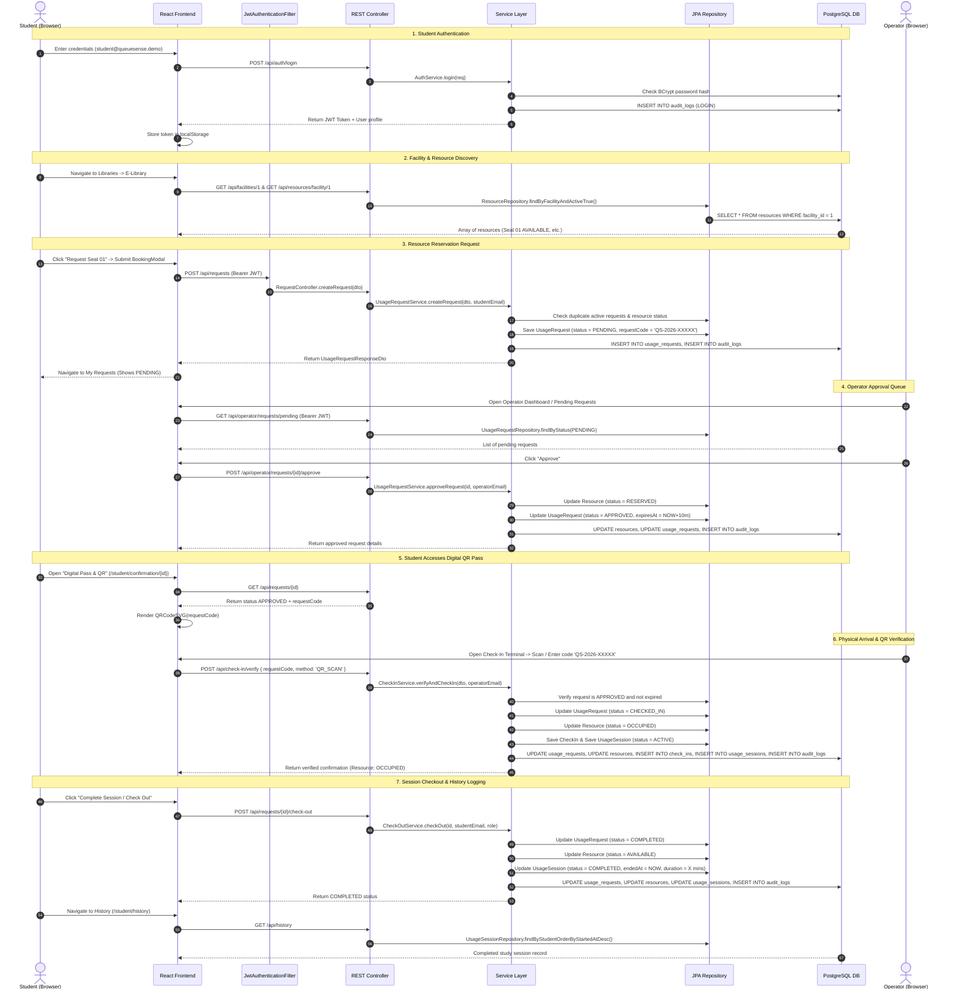

# QueueSense — Student & Operator End-to-End Workflow Trace

## 1. Complete Workflow Sequence Diagram

---

## 2. Step-by-Step Code Component Mapping

| Step | Action | Frontend Component | REST API Endpoint | Controller & Service | Database Mutation |
| :--- | :--- | :--- | :--- | :--- | :--- |
| **1** | Student Sign In | `LoginPage.jsx` | `POST /api/auth/login` | `AuthController` -> `AuthService` | Inserts `audit_logs` (LOGIN) |
| **2** | View Facilities | `LibrariesList.jsx` | `GET /api/facilities` | `FacilityController` -> `FacilityService` | Read `facilities` |
| **3** | View Live Seating | `FacilityDetails.jsx` | `GET /api/resources/facility/{id}` | `ResourceController` -> `ResourceService` | Read `resources` |
| **4** | Submit Request | `BookingModal.jsx` | `POST /api/requests` | `RequestController` -> `UsageRequestService` | `INSERT INTO usage_requests` (`PENDING`), `INSERT INTO audit_logs` |
| **5** | Track Pending Status | `MyRequests.jsx` | `GET /api/requests/my` | `RequestController` -> `UsageRequestService` | Read `usage_requests` |
| **6** | View Operator Queue | `OperatorDashboard.jsx`, `OperatorRequests.jsx` | `GET /api/operator/requests/pending` | `OperatorController` -> `UsageRequestService` | Read `usage_requests` (`PENDING`) |
| **7** | Operator Approves | `OperatorRequests.jsx` | `POST /api/operator/requests/{id}/approve` | `OperatorController` -> `UsageRequestService` | `UPDATE usage_requests` (`APPROVED`), `UPDATE resources` (`RESERVED`), `INSERT INTO audit_logs` |
| **8** | View QR Pass | `DigitalConfirmation.jsx` | `GET /api/requests/{id}` | `RequestController` -> `UsageRequestService` | Read `usage_requests` (renders `qrcode.react`) |
| **9** | QR / Code Verification | `OperatorCheckIn.jsx` | `POST /api/check-in/verify` | `CheckInController` -> `CheckInService` | `UPDATE usage_requests` (`CHECKED_IN`), `UPDATE resources` (`OCCUPIED`), `INSERT INTO check_ins`, `INSERT INTO usage_sessions` (`ACTIVE`), `INSERT INTO audit_logs` |
| **10** | Student Checkout | `StudentDashboard.jsx`, `MyRequests.jsx` | `POST /api/requests/{id}/check-out` | `RequestController` -> `CheckOutService` | `UPDATE usage_requests` (`COMPLETED`), `UPDATE resources` (`AVAILABLE`), `UPDATE usage_sessions` (`COMPLETED`), `INSERT INTO audit_logs` |
| **11** | View Historical Logs | `StudentHistory.jsx`, `OperatorHistory.jsx` | `GET /api/history` | `HistoryController` -> `UsageSessionRepository` | Read `usage_sessions` |
